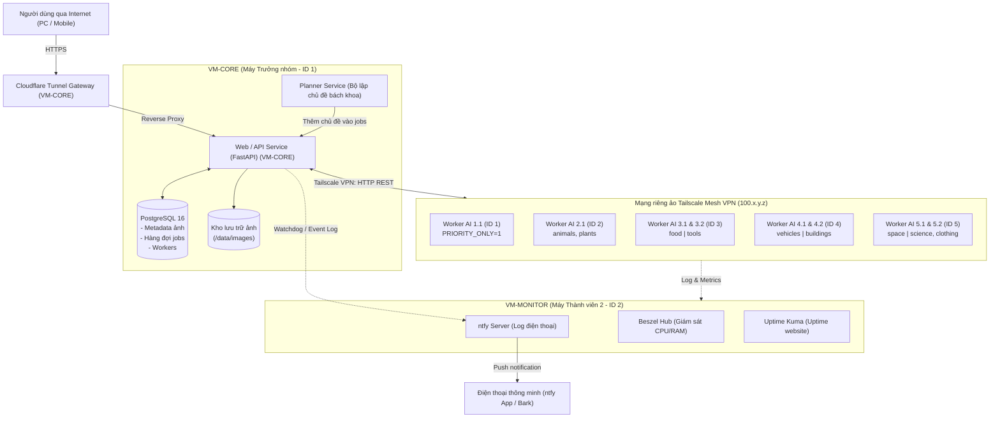
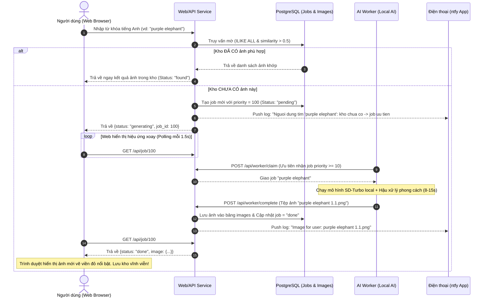

# BÁO CÁO THIẾT KẾ MÔ HÌNH VÀ PHÂN CHIA CÔNG VIỆC BÀI TẬP 03 (BT-03)
## ĐỀ TÀI: KHO ẢNH TRỰC TUYẾN THÔNG MINH (HỆ THỐNG SINH ẢNH AI PHÂN TÁN)

---

### BẢNG THÔNG TIN DỰ ÁN

| Hạng mục | Chi tiết |
|---|---|
| **Mã bài tập** | **BT-03** – Bài tập thực hành xếp hạng nhóm |
| **Quy mô nhóm** | **05 thành viên** (Huy động 100% máy tính cá nhân tham gia) |
| **Môi trường ảo hóa** | Máy ảo **VMware Ubuntu Server** chạy trên máy từng thành viên |
| **Mô hình AI Local** | **SD-Turbo** (`stabilityai/sd-turbo` chạy thuần CPU, không dùng AI API) |
| **Phong cách đồ họa** | Hỗ trợ đầy đủ **12 phong cách bách khoa toàn thư** (cấu hình biến `GROUP`) |
| **Kênh kết nối liên máy** | **Tailscale Mesh VPN** (Zero-trust, không mở port modem) |
| **Cổng phát hành Internet** | **Cloudflare Tunnel** (`https://[tên].trycloudflare.com`) |
| **Kênh giám sát di động** | **ntfy** (push notification trên điện thoại) + **Bark** (iOS) |
| **Dashboard giám sát** | **Beszel Hub + Agent** (tài nguyên CPU/RAM) và **Uptime Kuma** (uptime) |

---

## 1. TỔNG QUAN KIẾN TRÚC HỆ THỐNG

Hệ thống được thiết kế theo mô hình **Kiến trúc phân tán Microservices ghép nối lỏng (Loose Coupling)** kết hợp **Hàng đợi ưu tiên bất đồng bộ (Asynchronous Priority Queue)**.



---

## 2. THIẾT KẾ CÁC MODULE ĐỘC LẬP & KHẢ NĂNG NÂNG CẤP

Mỗi thành phần trong hệ thống được cấu trúc khép kín với Dockerfile và `docker-compose.yml` riêng biệt:

### 2.1. Module CSDL & Hàng đợi (`core/db`)
- **Công nghệ**: PostgreSQL 16 Alpine với extension `pg_trgm`.
- **Cơ chế hàng đợi chịu tải**: Bảng `jobs` vận hành cơ chế hàng đợi phân tán bằng truy vấn:
  ```sql
  SELECT id FROM jobs WHERE status='pending' ... 
  ORDER BY priority DESC, id FOR UPDATE SKIP LOCKED LIMIT 1
  ```
  `FOR UPDATE SKIP LOCKED` đảm bảo loại bỏ 100% tình trạng tranh chấp (race condition) khi nhiều AI Worker cùng gửi yêu cầu nhận việc đồng thời, không cần cài đặt thêm Redis hay RabbitMQ.

### 2.2. Module Web & RESTful API (`core/api`)
- **Công nghệ**: FastAPI (Python 3.11), Uvicorn, Pillow, HTML5/CSS3/Vanilla JS.
- **Tính năng chính**:
  + `GET /`: Phục vụ giao diện web đơn trang (Single Page Application) siêu nhẹ, tải nhanh qua 4G.
  + `GET /api/latest`: Lấy danh sách 50 ảnh mới nhất trong kho (`created_at DESC, id DESC`).
  + `GET /api/search?q=...`: Tìm kiếm gần đúng theo tên tiếng Anh bằng `ILIKE ALL` và `similarity()` của pg_trgm.
  + `POST /api/worker/claim` & `POST /api/worker/complete`: Giao thức giao nhận việc và tải ảnh lên an toàn bằng `multipart/form-data` có kiểm thực token bảo mật (`X-Token`).
  + `Watchdog định kỳ`: Kiểm tra heartbeat của các AI Worker, gửi thông báo cảnh báo nếu có worker nào ngắt kết nối > 5 phút.

### 2.3. Module Điều phối Danh mục (`core/planner`)
- **Công nghệ**: Python 3.11 Slim, Requests, từ điển bách khoa toàn thư 9 nhóm chuyên đề, hỗ trợ mở rộng kết nối LLM nội bộ qua Ollama (`qwen2.5:1.5b`).
- **Nhiệm vụ**: Giữ độ sâu hàng đợi (`backlog`) luôn duy trì từ 6 job trở lên cho mỗi danh mục, tự động ghép danh từ với các màu sắc bách khoa để tạo prompt sinh ảnh đa dạng.

### 2.4. Module AI Worker (`worker/`)
- **Công nghệ**: HuggingFace `diffusers`, PyTorch CPU (`torch_dtype=float32`), mô hình `stabilityai/sd-turbo`, Pillow Image Processing Engine.
- **Ưu điểm vượt trội**:
  + Mô hình **SD-Turbo** được huấn luyện theo phương pháp chưng cất đối kháng (ADD), chỉ cần **1 hoặc 2 bước suy diễn** (`steps=1-2`, `guidance_scale=0.0`) là cho ra ảnh chất lượng cao. Chạy thuần túy trên CPU máy ảo mà không cần GPU rời.
  + **Độc lập tuyệt đối**: Worker chỉ giao tiếp với trung tâm qua HTTP REST endpoint của API. Việc tắt, bật, cấu hình lại hay nâng cấp mã nguồn worker không gây bất kỳ ảnh hưởng nào đến CSDL hay API trung tâm.

### 2.5. Module Cổng Internet Gateway (`core/tunnel`)
- **Công nghệ**: Cloudflare Tunnel (`cloudflared`).
- **Nhiệm vụ**: Mở một đường hầm mã hóa TLS kết nối an toàn từ cổng 8000 của Web/API ra Internet công khai (dạng URL: `https://[ngau-nhien].trycloudflare.com`), vượt qua mọi rào cản tường lửa và địa chỉ IP động của mạng gia đình.

### 2.6. Module Giám sát & Nhật ký di động (`monitor/`)
- **Công nghệ**: ntfy server, Beszel Hub + Agent, Uptime Kuma.
- **Nhiệm vụ**: Thu thập số liệu tài nguyên (CPU, RAM, Disk) qua `beszel-agent` và gửi cảnh báo thời gian thực về ứng dụng di động ntfy trên điện thoại của các thành viên.

---

## 3. THIẾT KẾ CÁC LUỒNG XỬ LÝ (FLOWCHARTS)

### 3.1. Luồng Người dùng tìm kiếm: Ảnh có sẵn vs. Tự vẽ ảnh mới tức thì



---

## 4. MÔ HÌNH PHÂN BỔ TÀI NGUYÊN CHO NHÓM 5 THÀNH VIÊN

Tất cả 5 thành viên trong nhóm đều tham gia 100% vào việc chạy các máy ảo VMware Ubuntu Server, kết nối chung vào mạng Tailscale Mesh VPN:

| ID | Thành viên | Máy ảo đảm nhiệm | Tiến trình AI (Đuôi ảnh) | Danh mục AI phụ trách | Cấu hình máy ảo khuyến nghị |
|:---:|---|---|---|---|---|
| **1** | **Nhóm trưởng** (Máy mạnh nhất) | **VM-CORE**<br>+ **VM-WORKER** | **AI 1.1**<br>(`PRIORITY_ONLY=1`) | Chuyên trách phục vụ người dùng tìm kiếm tức thời | **VM-CORE**: 2 vCPU / 4 GB RAM / 20 GB Disk<br>**VM-WORKER**: 4 vCPU / 8 GB RAM / 30 GB Disk |
| **2** | **Thành viên 2** (Giám sát) | **VM-MONITOR**<br>+ **VM-WORKER** | **AI 2.1** | `animals, plants`<br>(Động vật & Thực vật) | **VM-MONITOR**: 2 vCPU / 2 GB RAM / 15 GB Disk<br>**VM-WORKER**: 4 vCPU / 8 GB RAM / 30 GB Disk |
| **3** | **Thành viên 3** | **VM-WORKER** | **AI 3.1**<br>**AI 3.2** | `food` (Ẩm thực)<br>`tools` (Công cụ lao động) | **VM-WORKER**: 4–6 vCPU / 8–12 GB RAM / 30 GB Disk<br>(Chạy song song 2 worker bằng `--profile two`) |
| **4** | **Thành viên 4** | **VM-WORKER** | **AI 4.1**<br>**AI 4.2** | `vehicles` (Phương tiện)<br>`buildings` (Công trình) | **VM-WORKER**: 4–6 vCPU / 8–12 GB RAM / 30 GB Disk<br>(Chạy song song 2 worker bằng `--profile two`) |
| **5** | **Thành viên 5** | **VM-WORKER** | **AI 5.1**<br>**AI 5.2** | `space` (Vũ trụ thiên văn)<br>`science, clothing` (Khoa học & Trang phục) | **VM-WORKER**: 4–6 vCPU / 8–12 GB RAM / 30 GB Disk<br>(Chạy song song 2 worker bằng `--profile two`) |

> **Tổng thể năng lực tính toán của nhóm:**
> - **05 máy ảo Worker** phân tán chạy trên 5 máy tính vật lý độc lập.
> - **08 tiến trình AI** chạy liên tục ở chế độ nền (7 tiến trình lấp đầy 9 danh mục bách khoa + 1 tiến trình thường trực đón đầu lượt tìm kiếm của người dùng).
> - **01 cụm Core** (DB + API + Planner + Cloudflare Tunnel).
> - **01 cụm Monitor** (ntfy + Beszel + Uptime Kuma).

---

## 5. BẢNG ĐỐI CHIẾU 12 PHONG CÁCH ĐỒ HỌA THEO ĐỀ BÀI

Mã nguồn trong `worker/styles.py` đã hỗ trợ sẵn cả 12 phong cách đồ họa của đề bài. Nhóm chỉ cần sửa biến `GROUP=<số nhóm>` trong file `.env` của worker:

| Nhóm | Tên phong cách | Giải pháp Prompt Engineering | Thuật toán Hậu xử lý ảnh (Pillow Engine) |
|:---:|---|---|---|
| **1** | **Pixel art** | `pixel art, 16-bit sprite, limited color palette, square pixels` | Thu nhỏ 64x64, lượng tử hóa 24 màu (`quantize`), phóng to nội suy lân cận (`NEAREST`) |
| **2** | **Van Gogh xoáy** | `in the style of Vincent van Gogh, swirling thick impasto brush strokes, vivid blue and yellow` | Giữ nguyên vân cọ sơn dầu nguyên bản từ SD-Turbo |
| **3** | **Mondrian geometric** | `Piet Mondrian De Stijl, flat primary colors red yellow blue, thick black grid lines` | Áp dụng `posterize` màu nguyên bản, tăng độ tương phản các mảng hình học |
| **4** | **Ukiyo-e** | `ukiyo-e Japanese woodblock print, flat colors, bold outlines, washi paper texture` | Tái hiện kết cấu giấy washi và đường viền tranh khắc gỗ Nhật Bản |
| **5** | **Màu nước** | `watercolor painting, soft translucent washes, paper texture, white background` | Loang màu mờ nhẹ tự nhiên trên nền giấy trắng mỹ thuật |
| **6** | **Neon** | `glowing neon sign, bright neon light lines on pure black background` | Tăng bão hòa màu 1.8x, tạo vầng sáng phát quang bằng `GaussianBlur(5)` và trộn ảnh `Screen` |
| **7** | **Blueprint** | `technical blueprint drawing, white line schematic, on blue paper` | Chuyển sang ảnh thang xám độ tương phản cao, nhuộm màu xanh kỹ thuật (`Colorize`) |
| **8** | **Khắc gỗ đen trắng** | `black and white woodcut print, linocut, bold carved lines, high contrast engraving` | Nhị phân hóa điểm ảnh theo ngưỡng (`point threshold`), tạo nét khắc mộc đen trắng tuyệt đối |
| **9** | **Pop art** | `pop art, Roy Lichtenstein style, bold black outlines, flat bright colors, ben-day dots` | Tăng cường độ rực màu 1.7x, áp dụng `posterize(bits=2)` cho mảng màu truyện tranh cổ điển |
| **10** | **Art deco** | `art deco poster, symmetrical geometric design, gold and black, elegant 1920s` | Đối xứng hình học sang trọng phong cách thập niên 1920 |
| **11** | **Hoạt hình / Đất nặn** | `claymation plasticine clay figure, stop motion, soft studio lighting, cute` | Hiệu ứng tạo hình đất nặn stop-motion đổ bóng mềm studio |
| **12** | **Halftone báo cũ** | `old newspaper photo, halftone dots, grayscale print, aged yellow paper` | Quét ma trận điểm ảnh, vẽ chấm tròn halftone theo độ sáng trên nền giấy ố vàng (`#e8dcbe`) |

---

## 6. PHÂN CHIA CÔNG VIỆC CHI TIẾT (MA TRẬN RACI CHO 5 NGƯỜI)

| Công việc / Giai đoạn | TV 1 (Trưởng nhóm) | TV 2 | TV 3 | TV 4 | TV 5 |
|---|:---:|:---:|:---:|:---:|:---:|
| Khởi tạo kho mã nguồn Git & cấu hình Tailscale Tailnet chung | **R** / **A** | C | C | C | C |
| Triển khai máy ảo VM-CORE (PostgreSQL, FastAPI, Planner, Cloudflare Tunnel) | **R** / **A** | I | I | I | I |
| Triển khai máy ảo VM-MONITOR (Beszel Hub, Uptime Kuma, ntfy) | I | **R** / **A** | I | I | I |
| Cài đặt Docker & chạy Worker AI 1.1 (Priority Only) trên VM-WORKER | **R** | I | I | I | I |
| Cài đặt Docker & chạy Worker AI 2.1 (animals, plants) trên VM-WORKER | I | **R** | I | I | I |
| Cài đặt Docker & chạy song song Worker AI 3.1 & 3.2 (food, tools) | I | I | **R** | I | I |
| Cài đặt Docker & chạy song song Worker AI 4.1 & 4.2 (vehicles, buildings) | I | I | I | **R** | I |
| Cài đặt Docker & chạy song song Worker AI 5.1 & 5.2 (space, science, clothing) | I | I | I | I | **R** |
| Kiểm thử chức năng tìm kiếm người dùng (Job Priority 100 & On-the-fly Generation) | C | C | C | **R** | C |
| Kiểm thử giám sát di động qua ntfy & đo lường tải CPU/RAM trên Beszel | C | **R** | C | C | C |
| Tổng hợp số liệu, xuất bản tệp báo cáo Word (.docx) & chụp ảnh minh chứng | C | C | C | C | **R** / **A** |
| **Cam kết mức độ đóng góp hoàn thành nhiệm vụ** | **100%** | **100%** | **100%** | **100%** | **100%** |

*(Ghi chú ký hiệu RACI: **R** - Responsible: Người trực tiếp thực hiện; **A** - Accountable: Người chịu trách nhiệm phê duyệt cuối cùng; **C** - Consulted: Người phối hợp/tham vấn; **I** - Informed: Người nhận thông tin).*

---

## 7. BẢNG KIỂM TRA ĐỐI CHIẾU YÊU CẦU ĐỀ BÀI (CHECKLIST NGHIỆM THU)

| STT | Yêu cầu trong đề bài | Hiện trạng triển khai trong mã nguồn zip | Đánh giá |
|:---:|---|---|:---:|
| 1 | Có các tiến trình AI local (không dùng API ngoài) tự chia việc chạy liên tục phía sau | Mô hình `stabilityai/sd-turbo` chạy thuần túy trên CPU máy ảo qua HuggingFace `diffusers`. Tự chia 9 danh mục qua biến `CATEGORIES` và hàng đợi SQL. | **ĐẠT (100%)** |
| 2 | Kích thước ảnh đơn giản cỡ nhỏ (≥ 128x128 pixel) | Mặc định `GEN_SIZE=512`, `OUT_SIZE=256` (256x256 px ≥ 128x128 px). | **ĐẠT (100%)** |
| 3 | Trang chủ luôn hiển thị tầm 50 ảnh mới nhất kèm tên ảnh | Endpoint `/api/latest?limit=50` sắp xếp `created_at DESC, id DESC`. Giao diện hiển thị dạng lưới thẻ ảnh kèm tên file. | **ĐẠT (100%)** |
| 4 | Có ô tìm kiếm theo tên ảnh tiếng Anh | Ô input tìm kiếm tiếng Anh tại đầu trang chủ, hỗ trợ tìm gần đúng bằng `ILIKE ALL` và pg_trgm. | **ĐẠT (100%)** |
| 5 | Phần cuối trang thống kê chi tiết số lượng ảnh theo từng AI | Bảng thống kê chân trang (`/api/stats`): mã AI (`thành viên.số AI`), số ảnh đã sinh, thời gian hoạt động gần nhất. | **ĐẠT (100%)** |
| 6 | Quy ước tên ảnh: `<tên tiếng Anh> <ID_thành_viên>.<số_AI>.png` | File `main.py` tự động định dạng: `f"{j['name']} {worker_id}.png"`. Ví dụ: `black dog 2.1.png`. | **ĐẠT (100%)** |
| 7 | Tìm kiếm chưa có ảnh: tự sinh ngay trong phiên, không bao giờ báo "không có kết quả", lưu lại kho | Tạo job `priority=100`, worker ưu tiên vẽ ngay trong 8-15s, giao diện hiển thị đếm giây, trả về ngay phiên làm việc và lưu vĩnh viễn vào CSDL. | **ĐẠT (100%)** |
| 8 | Kho ảnh đúng phong cách được giao, chủ đề bách khoa toàn thư | 9 danh mục từ điển bách khoa + module `styles.py` sẵn sàng 12 phong cách nghệ thuật kèm bộ lọc số Pillow. | **ĐẠT (100%)** |
| 9 | Website phát hành công khai qua Internet | Cloudflare Tunnel tích hợp sẵn trong container `tunnel`, tự sinh URL công khai `https://xxx.trycloudflare.com`. | **ĐẠT (100%)** |
| 10 | Nhóm huy động 100% các máy tính thành viên tham gia | Phân bổ chi tiết 5 máy thành viên, đảm bảo cả 5 người đều chạy máy ảo VMware Ubuntu Server tham gia tính toán. | **ĐẠT (100%)** |
| 11 | Module độc lập trên VMware Ubuntu Server, nâng cấp riêng rẽ | 3 thư mục độc lập `core/`, `worker/`, `monitor/` tương ứng với các `docker-compose.yml` riêng biệt. | **ĐẠT (100%)** |
| 12 | Xem log hoạt động chi tiết trên điện thoại qua ntfy / Bark | Tích hợp sẵn `notify()` đẩy tin tức thì: AI online, vẽ ảnh, lỗi worker, cảnh báo offline > 5 phút, tổng kết 10 phút. | **ĐẠT (100%)** |
| 13 | Giám sát trực quan toàn bộ hệ thống bằng phần mềm nguồn mở | Dựng sẵn **Beszel** (giám sát CPU/RAM phân tán) và **Uptime Kuma** (giám sát uptime website). | **ĐẠT (100%)** |
